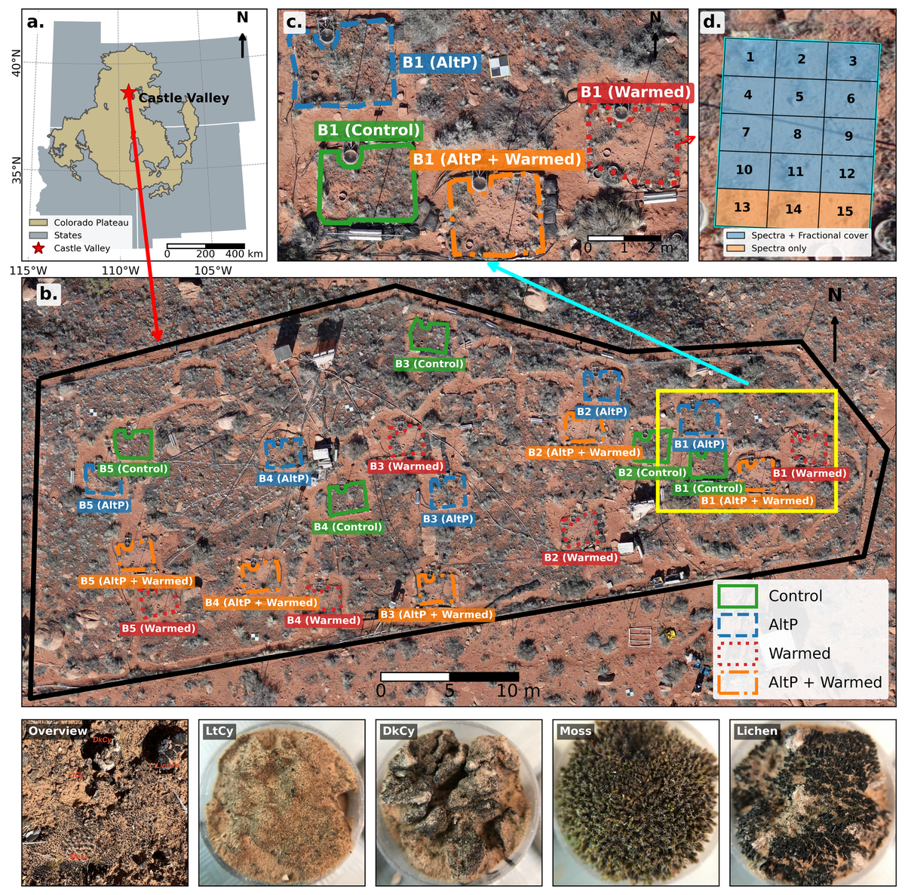
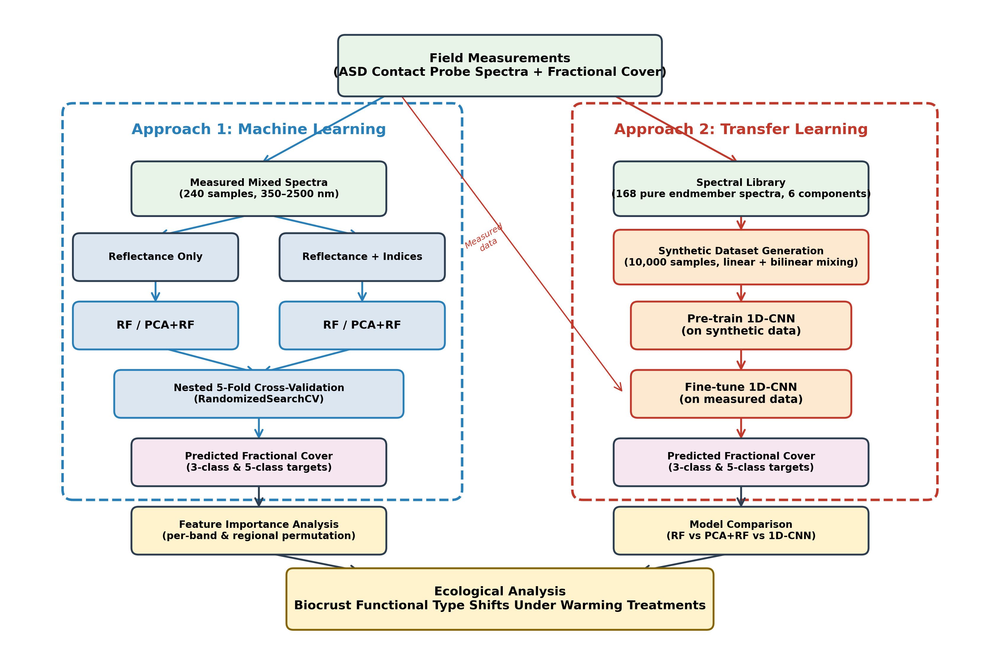

<div align="center">

<h1>Field spectroscopy estimates the fractional cover of biocrust successional stages and recovers an experimentally induced successional regression</h1>

[Fujiang Ji](https://fujiangji.github.io/) <sup>1, *</sup>, [Sasha C. Reed](https://www.usgs.gov/staff-profiles/sasha-reed) <sup>2</sup>, [Miguel L. Villarreal](https://www.usgs.gov/staff-profiles/miguel-villarreal) <sup>3</sup>, [Cara Lauria](https://www.usgs.gov/staff-profiles/cara-marie-lauria) <sup>2</sup>, [William A. Rutherford](https://snre.arizona.edu/william-austin-rutherford) <sup>1, 4</sup>, [Min Chen](https://globalchange.cals.wisc.edu/staff/chen-min/) <sup>5</sup>, [Armin Howell](https://www.researchgate.net/profile/Armin-Howell) <sup>2</sup>, [William K. Smith](https://snre.cals.arizona.edu/people/william-smith) <sup>1</sup>

<sup>1</sup> School of Natural Resources and the Environment, University of Arizona, Tucson, AZ, USA  
<sup>2</sup> U.S. Geological Survey, Southwest Biological Science Center, Moab, UT, USA  
<sup>3</sup> U.S. Geological Survey, Western Geographic Science Center, Moffett Field, CA, USA  
<sup>4</sup> U.S. Department of Interior, Bureau of Land Management, Arizona State Office, Tucson, AZ, USA  
<sup>5</sup> Department of Forest and Wildlife Ecology, University of Wisconsin–Madison, Madison, WI, USA

</div>

<p align='center'>
  <a href="#"></a>
</p>

## Summary
* Biological soil crusts (biocrusts) are key components of dryland ecosystems, but climate-driven shifts in their community composition remain difficult to monitor beyond field plots. Most remote-sensing studies emphasize categorical classification rather than continuous estimation of the fractional cover of biocrust functional types (BFTs) within mixed surfaces.
* We evaluated a framework for estimating biocrust fractional cover from naturally mixed field spectra (ASD FieldSpec 3, 350–2500 nm) in a long-term (since 2005) climate manipulation experiment at Castle Valley, Utah (Colorado Plateau). The previously documented warming-driven successional regression at this site (Phillips et al., 2022) served as an ecological benchmark.
* Two approaches were compared under identical nested cross-validation: Random Forest (RF) regression on measured spectra, and transfer learning with a one-dimensional convolutional neural network (1D-CNN) pre-trained on synthetic mixtures generated from a local endmember library and fine-tuned on 240 measured spectra.
* Under the successional-stage (4-class) scheme, the fine-tuned 1D-CNN reached _R²_ = 0.584 (early successional, LtCy), 0.576 (late successional, DkCy + lichen + moss), 0.515 (senescent vegetation) and 0.139 (bare substrate), compared with best RF-based _R²_ of 0.542, 0.461, 0.477 and 0.141. Under the individual-BFT (6-class) scheme, estimates were strongest for lightly pigmented cyanobacteria (_R²_ = 0.570), followed by moss (0.443) and darkly pigmented cyanobacteria (0.384), whereas lichen remained difficult to estimate (0.124).
* Model-estimated cover recovered the direction and rank order of the documented treatment effects. Under combined warming and altered precipitation, measured late-successional cover declined by 37.3 ± 19.2 percentage points and early-successional cover increased by 36.3 ± 10.9 percentage points; the corresponding estimates were −22.6 ± 10.4 and +32.5 ± 6.7 percentage points (mean ± SD across five blocks).

## Description of data
The `0_data/` folder contains the raw inputs used in this study:
* `ASD_Spectra/ASD_All_Spectra_PlotLevel.csv` — subplot-level reflectance of naturally mixed surfaces (350–2500 nm, interpolated to 1 nm), 300 spectra (4 treatments × 5 blocks × 15 subplots). Subplots 1–12 of each plot (240 spectra) have paired cover observations and are used for modeling.
* `ASD_Spectra/ASD_All_Spectra_ContactProbe.csv` — pure endmember spectral library: 168 sample-level spectra (each the mean of five contact-probe measurements) in eight categories: darkly pigmented cyanobacteria (DkCy, n = 36), lightly pigmented cyanobacteria (LtCy, n = 36), lichen (n = 36), moss (n = 36), vegetation (n = 9), litter (n = 9), rock (n = 3) and bare soil (n = 3).
* `USGS_Cover_Data/FractionaCover_BySpectra_2021_v2.csv` — point-intercept cover matched to each subplot spectrum (USGS).

Prediction targets:
* **4-class (successional stage) scheme**: late successional (DkCy + lichen + moss), early successional (LtCy), senescent vegetation, bare substrate.
* **6-class (individual BFT) scheme**: DkCy, lichen, moss, LtCy, senescent vegetation, bare substrate.
* *Senescent vegetation* = litter + live + dead vascular vegetation. Because the point-intercept survey records multiple vertical layers, this target can exceed 100%. *Bare substrate* = rock + bare soil.

Processed tables and synthetic mixtures are not included because they are regenerated by the scripts.


<p align="center"><b>Fig. 1.</b> Castle Valley long-term climate manipulation experiment (38.67°N, 109.42°W), Colorado Plateau, Utah: four treatments (Control, altered precipitation [AltP], Warmed, AltP + Warmed) × five replicate blocks × 15 subplots per plot.</p>

## Modeling framework
* **Pure-endmember separability.** RF classification (500 trees, stratified 5-fold cross-validation) of the endmember library under the 4-class and 6-class groupings, with per-band feature importance.
* **Approach 1 — Random Forest regression.** Eight configurations (RF or PCA + RF × reflectance only or reflectance + 9 spectral indices × 4-class or 6-class) evaluated with nested cross-validation: outer `KFold(5, shuffle=True, random_state=123)` for evaluation and inner `KFold(5, random_state=42)` with `RandomizedSearchCV` (60 draws) for tuning. Separate per-target RF models provide per-band feature importance. The 1320–1440 nm and 1770–1960 nm water-absorption regions are excluded (1,839 bands).
* **Approach 2 — Transfer learning (1D-CNN).**
  * *Synthetic mixtures*: 10,000 spectra generated from the eight-category library with linear or bilinear mixing (γ ∈ {0.25, 0.5, 1}); 1 to *k*<sub>max</sub> (4 or 8) categories per pixel, selected uniformly or in proportion to mean field cover; Dirichlet abundances (α ~ U(0.3, 1.0)); within-category variability represented by convex combinations of library spectra and a brightness factor ~ N(1, 0.05).
  * *Network*: three convolutional blocks (kernels 7, 5, 3), adaptive pooling, a 128-unit fully connected layer with dropout, and a linear output layer.
  * *Training and evaluation*: data generation, preprocessing, pre-training and fine-tuning settings are optimized jointly with 60 Optuna trials per scheme, scored only by inner-validation _R²_. Fine-tuning uses the same five outer folds as the RF branch; every inner-fold model starts from the pre-trained weights and is early-stopped on its own inner-validation fold, and each outer fold is predicted by the mean of its five inner-fold models. Outer-test samples are never used for model selection. Results from bilinear mixing are reported in the paper.


<p align="center"><b>Fig. 2.</b> Workflow combining Random Forest regression on measured mixed spectra and a 1D-CNN transfer-learning pipeline pre-trained on synthetic mixtures and fine-tuned on measured spectra.</p>

## Requirements
* `python>=3.9`
* `numpy`, `pandas`, `scipy`, `scikit-learn`, `matplotlib`, `seaborn`
* `torch` (transfer-learning branch; a GPU is recommended)
* `geopandas`, `pyproj`, `gdal` (Figure 1 only)

## Usage
* Clone this repository
  ```
  git clone https://github.com/FujiangJi/Castle_valley_biocrust.git
  cd Castle_valley_biocrust
  ```
* Build the measured dataset (merges spectra with cover, builds the targets and computes the 9 spectral indices)
  ```
  cd 1_data_processing && python process_measured_data.py
  ```
* Random Forest branch (nested CV of the 8 configurations, per-target feature importance, pure-endmember classification)
  ```
  cd ../2_rf_analysis
  python 2_RF_analysis.py
  python 3_RF_seperate_feature_importance.py
  python 4_RF_pure_endmember_classification.py
  ```
* Transfer-learning branch (example: bilinear mixing, 4-class scheme; repeat for `bilinear_6scheme`, `linear_4scheme`, `linear_6scheme`)
  ```
  cd ../3_synthetic_approach
  python 2_synthetic_datasets.py --priors uniform matched                          # optional: export reference synthetic datasets
  python 3_pretrain_model.py --scheme bilinear_4scheme [--config <config.json>]
  python 4_fine_tune_model.py --scheme bilinear_4scheme [--config <config.json>] --final ensemble
  ```
  Without `--config`, the built-in default configuration is used.
* Generate figures
  ```
  cd ../4_figure_plotting && python Figure3.py    # etc.
  ```
RF outputs are written to `2_results/` and CNN outputs to `3_results/` (created at runtime). All random seeds are fixed (outer folds 123, inner folds 42, training and synthetic data 42). Approximate run times: RF nested CV ~10–17 h (CPU), per-target RF ~1 day (CPU).

## Description of files in this repository
* **`0_data/`**: raw ASD spectra and point-intercept cover data.
* **`1_data_processing/`**
  * **[process_measured_data.py](1_data_processing/process_measured_data.py)**: merges subplot spectra with cover data; builds `frac_Vegetation` (litter + live + dead) and `frac_Bare` (rock + bare soil); computes nine spectral indices (brightness index, NDVI, PRI, NDNI, NDWI, MCARI, CI, SCAI, BSCI); writes identical processed tables for both modeling branches with an md5 manifest.
* **`2_rf_analysis/`**
  * **[1_process_measured_data.py](2_rf_analysis/1_process_measured_data.py)**: same as `1_data_processing/process_measured_data.py`.
  * **[2_RF_analysis.py](2_rf_analysis/2_RF_analysis.py)**: nested-CV multi-output RF and PCA + RF for both schemes and both predictor sets.
  * **[3_RF_seperate_feature_importance.py](2_rf_analysis/3_RF_seperate_feature_importance.py)**: per-target RF models (nested CV) and per-band / per-index feature importance.
  * **[4_RF_pure_endmember_classification.py](2_rf_analysis/4_RF_pure_endmember_classification.py)**: RF classification of the pure endmember library (4-class and 6-class), confusion matrices and feature importance.
* **`3_synthetic_approach/`**
  * **[1_process_measured_data.py](3_synthetic_approach/1_process_measured_data.py)**: same as `1_data_processing/process_measured_data.py`.
  * **[2_synthetic_datasets.py](3_synthetic_approach/2_synthetic_datasets.py)**: exports reference synthetic datasets and a realism summary against the measured spectra (pre-training generates mixtures on the fly).
  * **[3_pretrain_model.py](3_synthetic_approach/3_pretrain_model.py)**: pre-trains the 1D-CNN on synthetic mixtures for one scheme.
  * **[4_fine_tune_model.py](3_synthetic_approach/4_fine_tune_model.py)**: nested-CV fine-tuning on measured spectra; writes `final_model_estimation_<scheme>.csv` (outer-test predictions) and `measured_data_apply_to_pretrained_model_<scheme>.csv` (pre-trained model without fine-tuning).
* **`4_figure_plotting/`**
  * **[Figure1.py](4_figure_plotting/Figure1.py)**: study area and sampling design (Fig. 1).
  * **[Figure2.py](4_figure_plotting/Figure2.py)**: spectral library, measured mixed spectra and cover by treatment (Fig. 2).
  * **[Figure3.py](4_figure_plotting/Figure3.py)**: model comparison, 4-class scheme (Fig. 3).
  * **[Figure4.py](4_figure_plotting/Figure4.py)**: model comparison, 6-class scheme (Fig. 4).
  * **[Figure5.py](4_figure_plotting/Figure5.py)**: per-band feature importance, reflectance-only RF (Fig. 5).
  * **[Figure5_RF_indices.py](4_figure_plotting/Figure5_RF_indices.py)**: contribution of spectral bands and indices (Fig. S1).
  * **[Figure5_comparison.py](4_figure_plotting/Figure5_comparison.py)**: pure-endmember classification vs. mixed-spectrum regression (Fig. S2).
  * **[Figure6.py](4_figure_plotting/Figure6.py)**: measured vs. estimated cover and residuals by block, 4-class scheme (Fig. 6 and Figs. S3–S6).
  * **[Figure7.py](4_figure_plotting/Figure7.py)**: measured vs. estimated cover and residuals by block, 6-class scheme (Figs. S7–S11).
  * **[Figure8.py](4_figure_plotting/Figure8.py)**: measured vs. estimated treatment effects (Fig. 7).
  * **[Figure_workflow.py](4_figure_plotting/Figure_workflow.py)**: workflow diagram.

## Reference
If you use our code or data, please cite:
```
Ji, F., Reed, S.C., Villarreal, M.L., Lauria, C., Rutherford, W.A., Chen, M., Howell, A.,
Smith, W.K. (under review). Field spectroscopy estimates the fractional cover of biocrust
successional stages and recovers an experimentally induced successional regression.
```

## Contact
```
fujiang@arizona.edu
wksmith@arizona.edu
```

## Credits
* The Castle Valley climate manipulation experiment is maintained by the U.S. Geological Survey Southwest Biological Science Center.
* This research was supported by the National Aeronautics and Space Administration (NASA) through the Earth Surface Mineral Dust Source Investigation (EMIT) Science and Applications Team (Grant 80NSSC24K0858) and by the U.S. Geological Survey National Land Imaging Program.
